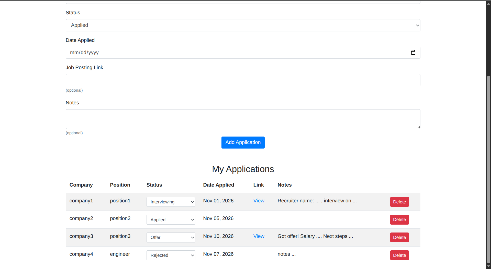
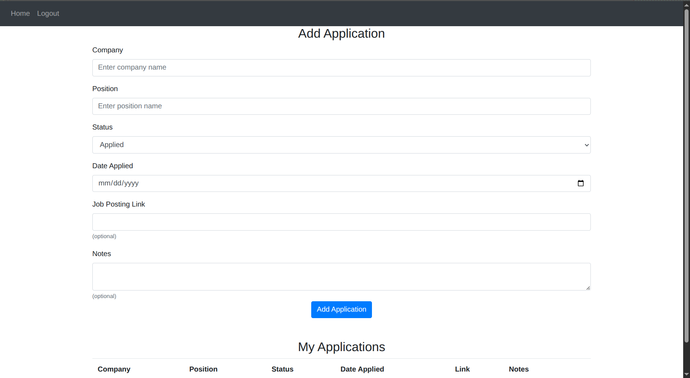
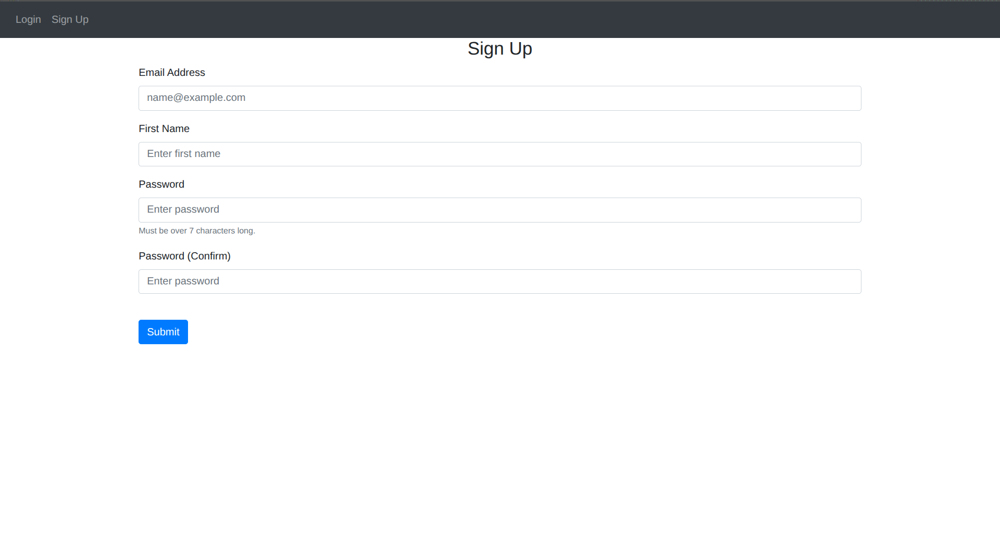
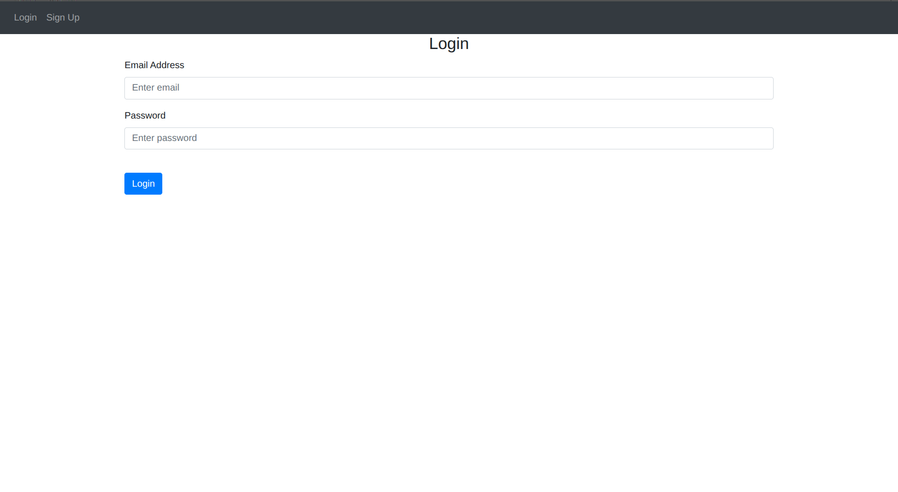

# Job Application Tracker

A web app for keeping track of job applications. Each user has their own account and can log/track the jobs they've applied to, update each application's status, and delete old ones.






## Features

- Sign up, log in and log out, with passwords stored as secure hashes
- Add applications with company, position, status, date applied, and optionally a link to the posting and/or notes
- See all your applications in one table
- Change an application's status from a dropdown (Applied, Interviewing, Offer, Rejected)
- Delete applications
- Each user can only see, edit and delete their own applications (checked on the server and hidden in the page)

## Built With

- Python and Flask
- Flask-SQLAlchemy with SQLite
- Flask-Login for user sessions
- Werkzeug for password hashing
- Jinja templates and Bootstrap 4

## Running It Locally

1. Clone the repo and go into the folder:

   ```bash
   git clone https://github.com/nathanjspriegel/job-application-tracker.git
   cd job-application-tracker
   ```

2. Create and activate a virtual environment:

   ```bash
   python3 -m venv .venv
   source .venv/bin/activate
   ```

3. Install the dependencies:

   ```bash
   pip install -r requirements.txt
   ```

4. Create a `.env` file in the project folder with a secret key:

   ```
   SECRET_KEY=put-random-secret-key
   ```

5. Start the app:

   ```bash
   python main.py
   ```

6. Open http://127.0.0.1:5000 in your browser and sign up.

The database is created in the `instance/` folder the first time the app runs.

## Planned Additional Features

- Edit all the details of an application, not just its status
- Filter table by status or date
- Statistics like total applications or response rate
